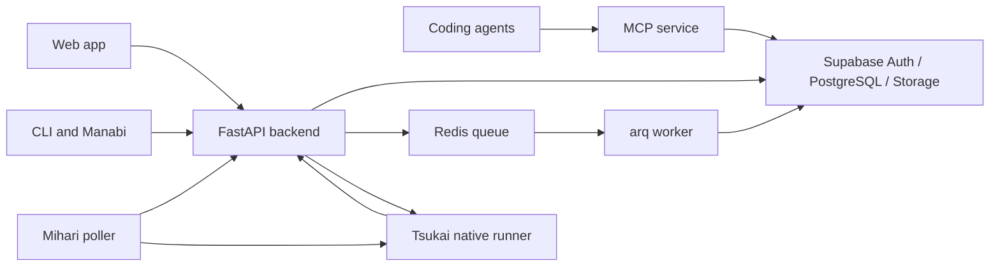

# Architecture

## Service boundaries

The FastAPI backend owns product authorization and canonical domain writes.
The separate MCP service exposes folder-scoped tools. The React frontend uses
REST and SSE. An arq worker processes queued jobs through Redis. Supabase hosts
Auth, PostgreSQL/pgvector, and file storage.

Mihari polls registered repositories, indexes code and graph data, and refreshes
briefings, documentation, and learnings. Manabi runs on a user's machine and
reports presence and repository inventory. Tsukai runs native Claude Code jobs
for explicitly enabled operations and credential owners.

## Retrieval: candidates before generation

1. `backend/services/search.py` embeds the query and retrieves vector and keyword
   document candidates, then fuses the legs with Reciprocal Rank Fusion.
2. Optional code candidates enter a joint rerank pool. Document/code retrieval is
   distinct from graph navigation; see `backend/services/tools.py` and the MCP
   registrations for which tools enable each path.
3. Voyage reranks the pool. Code reservation rules are implemented in
   `_rerank_with_code_reservation`; candidate counts and thresholds live in source.
4. `_apply_recency_decay` adjusts the returned ranking **after reranking**. It
   cannot recover a document excluded from the candidate pool.
5. Neighbor expansion adds adjacent document chunks for context.
6. The agent uses retrieved context and tool results to generate its answer.

The full search path can rewrite and expand the query before candidate retrieval.
The MCP fast path skips those LLM enrichment calls. Date filters constrain eligible
content; ingestion timestamps should not be described as meeting/event time.

`backend/services/rag.py` implements API-backed tool-use streaming. Native chat
uses the Tsukai conversation bridge and scoped backend tools instead. Do not
collapse these into one fixed sequence of model calls.

## Execution policy and native chat

`backend/services/ai/registry.py` registers operations and selects an engine.
API is the default. Native execution requires an enabled operation in
`TSUKAI_NATIVE_TASKS` and the matching `TSUKAI_CREDENTIAL_OWNER_ID`; the runtime
also enforces `TSUKAI_ENTITLED_OWNER_IDS`. OCR and evaluation judging are marked
unverified for native execution. Native failures are surfaced, not retried through
an API provider automatically.

The backend signs short-lived scope capabilities. Tsukai persists jobs, attempts,
events, conversation mappings, and acknowledgements in PostgreSQL, starts the
pinned native CLI, and exposes durable SSE replay. Provisional text is superseded
by terminal canonical output. A browser disconnect does not cancel a job.
Uncertain native sessions require explicit recovery from committed Kioku history.

The authenticated model catalog comes from native CLI initialization metadata.
It is cached; refresh failures can return stale data. Models requiring usage
credits are marked unselectable. Fresh-catalog admission rules and static pilot
models are enforced by the runtime. See [the protocol](../tsukai/protocol/README.md).

## Ingestion and persistence

Uploads and external drops store originals and enqueue ingestion. Workers parse,
chunk, extract metadata, embed with Voyage, deduplicate, and persist searchable
chunks. Notion sync feeds the ingestion pipeline. Redis is a queue/cache dependency;
it is not the durable source of Tsukai replay or repository knowledge.

Daily journals are a separate storage path and are not embedded into document
search. Learnings retain source links and commit evidence. See [agent memory](agent-memory.md).

## Authorization

JWT-authenticated product routes, scoped API-key routes, machine credentials, and
internal service/capability routes have different authorization contracts. RLS is
one layer; service-role access still requires correct application ownership and
folder-scope checks. Never describe the service role as automatically protected by
ordinary user RLS. Internal Tsukai transport credentials alone do not authorize a
tenant operation.

For source entry points and API discovery, see [backend](../backend/README.md) and
[integrations](integrations.md). For deployment boundaries, see [operations](operations.md).
