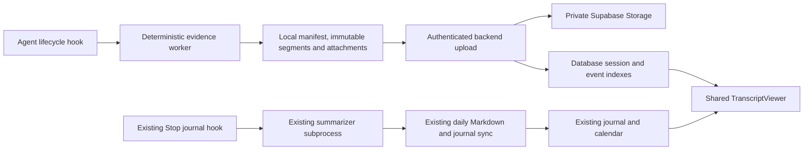

# Durable agent originals alongside the existing journal

**Date:** 2026-11-04
**Status:** Implementation specification; application changes have not been made.
**Integration baseline:** `origin/main` at `5c5eb1c6f03ec7cf65455cfa9c7c4f26cc9eb2ad`. The older `fix/folder-browser-history` checkout does not contain the current journal implementation. Implement against a baseline containing the journal, not by rebuilding it from that older checkout.
**Scope:** Claude Code and Codex original evidence, local durability, authenticated upload, private Storage, database navigation indexes, and a shared original-evidence reader. Preserve the existing journal extraction, daily files, summaries, calendar, and current-learnings pipeline.

## 1. Product decision and boundaries

Users must be able to inspect the original conversation supporting a journal entry months later, even without semantic recall or a maintained-memory system. Originals are archived evidence, not additional model-authored memories. The database indexes sessions and source locations; raw bodies live in Supabase Storage.

Keep these two independent flows:



**Original capture and transfer do not run in an LLM subagent.** A detached, bounded Kioku CLI process performs file I/O, hashing, segmentation, retry and HTTP transfer. It needs no model, prompt, tools, MCP reasoning loop or additional model cost. The existing journal still uses its native summarizer subprocess. Failure in either branch must not suppress the other. Their hook order is unspecified; evidence links may become available after a summary appears.

Out of scope: replacing journal prompts or formats; embeddings or semantic recall; new fact extraction/consolidation; a new Manabi service or always-running watcher; changes to Mihari judgment; importing every historical native session; porting the POC verbatim; a `manifests/` history directory; a new general file manager. This spec supersedes conflicting **original-evidence** proposals in older memory drafts, not the functioning journal contract.

### Verified existing integration points

| Area | Existing implementation to preserve or extend |
| --- | --- |
| Journal execution | `cli/src/commands/memory.ts`: `memoryCapture`, `memoryWorker`, `memorySync`; detached worker, native summarizer, session overview, local journal and MCP sync |
| Journal format | `cli/src/lib/agent-journal.ts`: free bullets, session title/overview, entry IDs and `source_ref`; `.kioku/memory/YYYY-MM-DD.md` |
| Hook installation | `cli/src/commands/init.ts`, `cli/src/lib/claude.ts`, `cli/src/lib/codex.ts`; current `memory-capture --agent ...` Stop handlers must survive |
| Journal persistence | `backend/services/agent_journal.py`, `agent_journal_days`, private `agent-journals` bucket; leave unchanged |
| Existing journal reads | `backend/routes/learnings.py`: `/api/folders/{folder_id}/learning-days` and dated day endpoint with IANA timezone |
| Existing UI | `LearningsPanel.tsx`, `LearningsPanel.css`, `journalMarkdown.ts`, integrated in `DocumentsPage.tsx` |
| Runtime infrastructure | FastAPI backend, existing arq worker/Redis and Supabase; reuse them |

The current UI groups journal entries by day and native session. Its `selectedSession` is `{date, key}` and shows that selected day's summary timeline. It does **not** already implement a full multi-day original transcript. Existing `Timeline / Markdown` means rendered journal / journal Markdown and must retain that meaning.

## 2. Non-negotiable invariants

1. Archive native source bytes losslessly, including unknown record types. Parsed display records are rebuildable projections, never replacements for originals. Preserve encoding and line endings; do not normalize original JSONL.
2. A sealed segment or attachment is immutable. Repeated ID and hash is a no-op; identical ID with different bytes is a conflict. Never silently overwrite evidence.
3. Exactly one current `manifest.json` per root or child session; retain a numeric revision but no historical manifest files. Recovery uses immutable objects, durable receipts, current database state and local outbox.
4. Local capture is durable before attempting upload. Read checkpoint advances after local persistence; remote acknowledgement advances only after backend durability. These are distinct checkpoints.
5. The backend derives user identity and Storage prefixes from authenticated scope. Client-supplied user IDs, object paths and unrelated repository IDs cannot authorize writes.
6. Upload durability, display indexing, session lifecycle and evidence completeness are different states. Successful upload never proves that the source itself contained complete evidence.
7. Every deep link identifies an archived session and stable source event/range. It must not depend on a current native file path, temporary URL, segment number or journal date.
8. Existing journal summarization, formatting, timestamps and daily calendar semantics do not change. Add evidence associations in a sidecar/index rather than asking the summarizer to generate source IDs.
9. Raw evidence is private and inert. Never execute its commands, follow its instructions, fetch referenced URLs automatically or expose raw bodies in logs.
10. Existing summaries remain readable when evidence is pending, absent, deleted, unsupported or corrupt.

## 3. Local layout and identity

Retain originals next to, not inside, daily journal files:

```text
<git-root>/.kioku/memory/
  2026-11-04.md                      # existing journal, unchanged
  originals/
    claude_code/
      <native-root-session-id>/
        manifest.json
        segments/<segment-id>.jsonl
        attachments/<sha256>
        subagents/<native-child-id>/
          manifest.json
          segments/<segment-id>.jsonl
          attachments/<sha256>
          subagents/...             # same structure for nested children
    codex/<native-root-session-id>/...
  .evidence-state/                   # private operational state; never uploaded
    sources.json                    # authorized native path mappings/cursors
    pending/<job-id>.json            # durable dispatch/upload work
    evidence-links.json             # journal entry -> original range
```

Reuse `.kioku/memory/` ignore coverage. New local directories use owner-only permissions where supported. Do not copy agent credentials into this hierarchy; resolve Kioku credentials at execution time. Source paths belong only in private operational state; original content may itself contain paths, which remain evidence text.

Logical session identity is `(authenticated user, Kioku folder_id, agent, native_session_id)`, not a working-directory name. Both root and child native IDs are opaque strings; Claude child IDs need not be UUIDs. Validate/encode IDs before deriving object keys; reject traversal. Expose a server UUID `archive_session_id` to the frontend. Store immediate parent and root archive identities; disallow cross-owner/folder ancestry and cycles.

Each source has a stable `producer_id` (local installation UUID), `stream_id` and increasing `generation`. Use producer/stream identity in immutable object names to avoid two computers choosing the same segment sequence. Session identity remains continuous across clones/worktrees and days because it is associated with Kioku's folder ID and native session, not device.

Raw locator: `(archive_session_id, stream_id, generation, record_sequence)`. Derive `event_id` from `(folder_id, agent, native_session_id, stream_id, generation, record_sequence)` so it can be assigned locally while offline, before the server session UUID exists. The server resolves that native identity to its archive UUID. A native content-block index can identify a part within the record; part suffixes must derive from native array/source positions, never parser-generated display grouping. Deep links always retain the stable base event anchor. Preserve native event IDs, turn IDs, parent IDs and call IDs as separate fields. Do not change a base event ID when the parser version changes. Native IDs can deduplicate verified identical copies in presentation; keep the raw provenance of every stored copy. Contradictory copies are visible conflicts, not timestamp-based last-writer-wins.

## 4. Capture, segmentation and attachments

### Native adapters

Create separate Claude/Codex adapters behind one capture interface: resolve authorized source, enumerate new complete records, extract identity/time/turn aliases, detect file generation changes, discover children and attachment references. Native record schemas are versioned observations, not permanent public contracts.

- **Claude:** use the hook's main `transcript_path`; preserve UUID and `parentUuid` branching. `SubagentStop.agent_transcript_path` identifies the child source. At child start, the available path may still identify the parent; register pending child discovery rather than mislabeling that path.
- **Codex:** distinguish native thread `id`, parent `session_id`, `parent_thread_id` and hook `agent_id`. In the POC, `SubagentStart` kept the parent session ID while supplying the child's transcript path. `SubagentStop` supplied an explicit child path. Never file those child bytes under the parent. Preserve compaction and inherited-context records. A child containing inherited parent history must not make that history look like work newly executed by the child.
- Native record forms not recognized by the parser remain archived and accessible in raw mode. An unsupported display parser must not prevent lossless capture of well-framed records.

Use hook-provided paths and an explicit mapping of encountered sessions. A resumed session can be weeks old: do not use the current journal helper's today/yesterday-only fallback for originals. Any fallback discovery is restricted to the native agent store and the specific known session ID; no unrestricted filesystem sweep and no ingestion of the other agent's sessions.

### Segment boundary rules

- At `Stop`, seal all available new complete JSONL records. No new records means no segment.
- During long turns, progress checkpoints seal new complete records once approximately **1 MiB uncompressed** accumulates. Small progress batches may be held until the next checkpoint; do not create one tiny object per tool call.
- `PreCompact`, child stop and session exit request a final local checkpoint of available records.
- Split only between complete native records. A single oversized record may exceed 1 MiB; report it as oversized, never truncate or split it invisibly.
- Read a snapshot up to the observed source length. An unfinished line, including a partial UTF-8 character, stays pending for the next checkpoint. Invalid complete records retain their exact bytes as flagged opaque/quarantined source records in both local and remote evidence; quarantine prevents interpretation, not durable archival. Subsequent records may be captured with the parse gap explicit. Do not silently skip bad bytes and claim continuous coverage. This improves on the POC's reject-before-advance behavior.
- Persist files, local manifest and source cursor with crash-safe replacement/fsync and a per-session lock. Windows must use an equivalent tested locking/rename strategy, not a POSIX-only implementation.
- Changed/truncated/replaced source prefixes start another generation. Preserve older archived generations. Do not assume every native file is append-only forever. Use file identity and boundary hashes; do not reread/hash the entire multi-month transcript at every hook as the POC did. Document the optimized fingerprint strategy and test same-size rewrite and rotation.

The 1 MiB value is a target, not a hard data-loss limit. Initial server object ceiling: **64 MiB**, subject to deployment provider limits. Larger records/attachments remain local, marked `blocked_size_limit`, and surface a gap until an explicit larger-object/multipart path is implemented. Batch/control requests are bounded separately. Neither client nor backend may silently shorten content to fit.

### Attachments and source fidelity

Capture referenced tool-result files in addition to transcript lines. The POC verified a complete Claude tool-result file that the transcript displayed only as a preview. Copy the original bytes under a content hash and retain original filename, MIME hint, size, native reference and linking event.

Resolve only attachment locations allowed by the source adapter's known native session roots. Reject traversal and symlink escapes; do not fetch arbitrary local paths or remote URLs found in conversation text. Missing files remain unresolved references, eligible for later checkpoint retry.

Codex tool output in the POC was truncated **before capture**; storing its transcript exactly did not recover the missing original output. Record `upstream_truncated`, `attachment_missing`, `opaque_payload`, `source_unreadable`, `capture_gap`, `unsupported_schema` and `blocked_size_limit` separately. Describe opaque content as unreadable unless its format explicitly establishes encryption. Raw mode cannot decrypt unavailable content.

The raw archive must not silently apply the journal's secret-redaction/size-normalization helpers: that would break original-byte fidelity. Preserve the authorized native content in private owner-scoped storage; redact operational logs and derived journal output as today. Provide repository-level capture enable/disable and deletion controls. Future redacted exports must be labeled derivatives and retain transformation provenance.

## 5. CLI hooks, workers and recovery

Add distinct commands, leaving `memory-capture`, `memory-worker` and `memory-sync` journal behavior intact:

| Command | Purpose |
| --- | --- |
| `kioku evidence-capture --agent claude_code\|codex` | Hidden hook entry: validate initialized repo/payload, persist dispatch intent and start/coalesce deterministic work |
| `kioku evidence-worker` | Hidden detached process: capture originals, discover dependencies, upload pending data; no LLM |
| `kioku evidence-sync` | Retry original-evidence capture/uploads for this initialized repository |
| `kioku evidence-status` | Local/remote status, last captured and acknowledged positions, pending bytes, gaps, supported hooks; no raw body/key printing |

Install both agent adapters idempotently through `kioku init`, inside the existing config lock. Claude uses its current repo-local **`.claude/settings.local.json`** installation convention; Codex uses its current global configuration and no-ops outside initialized repositories. Preserve unrelated hooks, current briefing hooks, journal Stop hooks and existing key reuse. Legacy-hook cleanup must recognize new evidence handlers and must not remove them on re-init.

| Event | Original-evidence responsibility |
| --- | --- |
| `SessionStart` | Register source/session, resume pending work and sweep only known stale captures; never finalize a still-active session merely because it resumed |
| `PostToolUse` | Throttled progress checkpoint for long turns; avoid a worker per call |
| `Stop` | Seal local tail and dispatch upload independently of journal completion |
| `SubagentStart` | Register parent/child identities early; capture available child source if unambiguous |
| `SubagentStop` | Capture child's own source, resolve parent link and tail attachments |
| `PreCompact` | Attempt bounded synchronous local tail preservation before source transformation; dispatch remaining network/index work |
| `SessionEnd` | Persist end/retry intent and attempt bounded local final tail capture; dispatch network work outside the hook budget |
| Optional supported failure/interrupt events | Checkpoint available evidence with the same dispatcher; not a substitute for the above |

Verify installed host schemas and hook trust behavior. Unsupported hooks degrade explicitly in `evidence-status`; never claim they ran. Do not auto-bypass the user's hook-trust review. Codex exit hooks are synchronous and host-owned background hooks may be cancelled at exit; therefore persist the retry marker **before** detaching. No network operation or model invocation belongs in the foreground hook.

Normal hook dispatch target: under **100 ms p95** on the test machine, excluding bounded emergency local-copy work at compaction/exit. Emergency copy must respect the host's deadline, report any uncopied range and leave retry intent; it cannot promise recovery if the host destroys bytes before they were copied. Use early progress checkpoints to reduce that tail. Synchronous local work is not synchronous upload.

One capturing worker per session; coalesce repeated requests. Bound parallel uploads to two per repository and four per installation, with crash-expiring ownership locks/leases. Workers drain bounded batches and exit rather than forming a permanent daemon. Persist pending jobs and source registry before launch so the next hook or explicit sync can recover a failed launch or killed worker, including a session whose first Stop never completed.

Offline/network/auth failures preserve local evidence. Use bounded exponential backoff with jitter and honor Retry-After. Authentication/scope failures become visible blocked states rather than hot retries. Disk-full/quota conditions never delete unacknowledged originals; pause capture with a diagnostic and retain the last safe checkpoint. No automatic local pruning in v1.

First encounter of an explicitly initialized active/resumed session may backfill that session's existing complete source records asynchronously, so its beginning is not silently lost. Do not bulk-import unrelated historical sessions. The init/status output states that original-session archival is enabled and that journal behavior is unchanged. Maintain an explicit repo-level `original_evidence_enabled` setting and backend rollout flag.

### Journal linkage without changing extraction

The evidence adapter must emit sidecar aliases matching existing journal entry IDs `(agent, session_id, turn_id)` and source refs. The current journal helper can use a user-message UUID or line-position fallback, which is not necessarily the native Codex turn ID. Preserve and test that alias convention; do not replace it and strand existing links.

Upload a deterministic association from `journal_entry_id` to archived turn/event range. Journal and evidence may arrive in either order. Link publication is idempotent and can remain pending until both exist. No model-generated link IDs. A new summary must not wait for remote evidence; a summarizer failure must not prevent original capture. Old entries without matching evidence show unavailable; optional session/date fallback is explicitly approximate and never labeled an exact entry range.

## 6. Single current manifest

Each local/root/child manifest is a versioned-schema current inventory, not a daily file:

```json
{
  "schema": 1,
  "agent": "codex",
  "native_session_id": "opaque-native-id",
  "native_parent_session_id": null,
  "revision": 7,
  "streams": [{"stream_id": "producer-stream-id", "producer_id": "installation-uuid", "generation": 1}],
  "segments": [{
    "id": "deterministic-object-id", "stream_id": "producer-stream-id", "generation": 1,
    "path": "segments/producer-stream-g1-000001-sha.jsonl", "sha256": "hex",
    "byte_length": 921600, "source_start": 0, "source_end": 921600,
    "first_record": 1, "last_record": 60, "record_count": 60,
    "first_event_at": "2026-11-04T12:00:00Z", "last_event_at": "2026-11-04T12:03:00Z"
  }],
  "attachments": [{"sha256": "hex", "path": "attachments/hex", "byte_length": 70031, "source_event_id": "opaque-event-id"}],
  "children": [{"native_session_id": "child-id", "manifest": "subagents/child-id/manifest.json"}],
  "coverage": {"captured_through": "source-position", "gaps": []},
  "lifecycle": {"status": "observed", "ended_at": null}
}
```

Timestamps may be null where the native record has no event time. Do not synthesize event time from upload time. The actual schema uses concrete typed source positions; the illustrative `source-position` string above is not an implementation type.

Local revision and server revision are separate counters; remote acknowledgement state is in `.evidence-state/`. A local manifest describes locally retained sources. The remote manifest is the authorized union of accepted producer streams. A device need not download every other device's bodies to upload its own tail. Merge by immutable identities and source coverage, not local revision arithmetic or wall-clock time.

## 7. Backend ingestion and Storage publication

Use a dedicated private **`agent-evidence`** bucket. Do not add raw JSONL/binary files to the Markdown-only `agent-journals` bucket or ordinary documents/embedding pipeline.

```text
agent-evidence/
  <server-derived-user-id>/<folder-id>/<agent>/<native-root-session-id>/
    manifest.json
    segments/<object-id>.jsonl
    attachments/<sha256>
    subagents/<native-child-id>/...
```

The CLI sends **both object bytes and inventory metadata**. Sending `manifest.json` alone does not archive originals. Use the existing repository-scoped Kioku API key via authenticated REST, resolved from existing CLI configuration; do not introduce Supabase service credentials into the CLI. This new transfer path is separate from unchanged journal MCP sync. Backend team must extract/reuse the actual scoped-key verification logic from the current CLI/MCP auth paths; `services/cli_auth.py` is browser-login handoff storage, not that verifier.

### Ingestion wire contract

All routes below are proposed additions under `/api/agent-evidence`; require scoped API-key authentication, explicit `folder_id`, owner/repository-kind/subtree validation, and feature capability negotiation.

1. **`POST /batches`** — register an idempotent bounded batch. Body: protocol version, folder, agent, native root/parent/session identity, producer/stream identities, `batch_id`, `base_revision`, object descriptors and journal aliases. At most 256 new descriptors per batch; paginate larger work. Response includes server archive/session IDs, current revision and missing object IDs. Client may not set a Storage path or user ID.
2. **`PUT /batches/{batch_id}/objects/{object_id}`** — stream the immutable original bytes through backend to private Storage. Enforce declared length, checksum and content limits; no base64 copies in JSON control messages. Response confirms durable staged object or matching duplicate. A conflicting object is 409. Backend owns keys and never dereferences client filesystem paths.
3. **`POST /batches/{batch_id}/commit`** — verify all referenced objects exist with matching hashes; validate per-stream coverage/identity and ancestry; apply additions with database compare-and-swap against `base_revision`. Publish current session manifest JSON and processing receipt transactionally. Return `accepted` with revision, receipt and `index_status`, or matching duplicate receipt. Missing objects produce an explicit incomplete-batch response, not success. A batch that depends on an uncommitted predecessor returns `dependency_pending` with missing IDs; retain its staged bytes and retry after that predecessor, without claiming continuous coverage. A stale revision is 409 with current revision; client reconciles descriptors and retries, preserving other producers.
4. **`GET /batches/{batch_id}`**, **`GET /sessions/{archive_session_id}/inventory`** — inspect durable status and paginated authorized object descriptors for recovery/conflict reconciliation. Never scan an entire user's Storage bucket to reconcile one session.
5. **`GET /capabilities`** — protocol/schema support, object/control limits and feature enablement. Old backend/no capability leaves originals local and reports unsupported; journal sync continues.

The transaction acknowledgement requires durable immutable objects plus a durable canonical database manifest/receipt and processing intent. It does not require a completed UI projection. Repeated commit after a lost response returns the original receipt without creating another event set.

A child can finish before its parent's first upload. Create an owner-scoped parent placeholder when the authenticated ancestry is known; publish the child relationship without requiring nonexistent parent bodies. Root/parent/child manifest metadata and revision updates must use a consistent lock order and the same CAS discipline. A root with no captured main transcript is explicitly pending. Child evidence remains discoverable through database ancestry while the single root Storage manifest is being refreshed.

### No false Storage/database atomicity

Supabase object writes and SQL commits are not one transaction. **The database stores the authoritative current `manifest_json`, hash and revision.** The single Storage `manifest.json` is a materialized copy; reads used by the app/CLI resolve the database manifest. An existing queue worker materializes/repairs that one file after commit. A stale or failed Storage copy must never select the wrong revision for a reader; compare revision/hash against the database and repair. This avoids relying on unsupported cross-service atomic rename or conditional object update.

Pending batches can leave unreferenced immutable objects. Track them by receipt, distinguish staged from committed, and reclaim only expired uncommitted staging after a configurable grace period (default seven days), with a final reference check. Never garbage-collect committed evidence because an index job failed. No `manifests/` snapshots are required for this protocol.

Backend processing uses the existing arq service with dedicated task names, timeouts/concurrency and a durable database pending-state reaper. Redis enqueue failure must not lose a committed processing job. Process revisions idempotently; an older worker cannot regress `indexed_revision` or replace newer indexes. New evidence does not require reparsing all historical objects. Reindexing from retained objects remains possible after parser upgrades.

## 8. Database index

Add an incremental migration and mirror it in `backend/db/schema.sql`. Use explicit foreign keys/composite ownership constraints, owner-read RLS and service-only writes. Suggested physical tables are the implementation contract; avoid a single unbounded JSON field containing every message body.

| Table | Required data and constraints |
| --- | --- |
| `agent_evidence_sessions` | Server UUID, user/folder/agent/native ID unique tuple; parent/root UUIDs; current manifest JSON/hash/revision; indexed revision and parser version; native first/last event times; observed/captured/ingested times; lifecycle, upload/index/gap/deletion statuses and counts. Parent/root must share owner/folder/agent. |
| `agent_evidence_objects` | Session, immutable object ID, producer/stream/generation, kind, Storage key, hash/bytes; segment source offsets and record range; attachment metadata/reference. Unique object identity, hash conflict forbidden; indexed coverage and staging/commit state. |
| `agent_evidence_events` | Stable event ID, session, object/raw byte offset/length, source record/part position, native event/turn/call/parent aliases, event time nullable, type/role, inheritance/provenance marker, parser version and normalized body availability. Header/locator index; large bodies remain in Storage. |
| `agent_evidence_journal_links` | User/folder, existing journal entry ID/date, session and start/end event references; exact/approximate/unresolved availability. Unique association/version policy; never invent a precise anchor. |
| `agent_evidence_batches` | Owner/folder/batch identity, expected base revision, content hash, durable receipt/state, object dependencies, pending processing/materialization work, attempts/error code/lease and timestamps. Same batch/hash idempotent; different hash conflict. |

Index session listings by user/folder/event activity; child lookups by parent; event windows by session and stable source order; date jumps by session/event time; links by user/folder/journal entry ID; pending jobs by state/next retry. Use efficient timezone-aware aggregation over indexed event timestamps; if measurements justify a day-bucket projection, it remains rebuildable and timezone-qualified, not a replacement source.

Do not call these rows consolidated semantic memories. They are the **original-memory archive/navigation index**, alongside existing `agent_journal_days` and `repo_learnings`. No embeddings or new maintained-memory lifecycle is introduced.

## 9. Normalization, dates and read API

The server parser retains raw events and builds a display projection distinguishing user, assistant, tool call/result, lifecycle and opaque records. Link calls/results by native call identity, not nearest timestamp. Preserve unmatched calls, duplicates/inherited context and uncertainty. Prefer the appropriate native representation for the body without discarding richer tool output present elsewhere in the raw record; the POC's projection was diagnostic and omitted some native fields. Unknown fields remain inspectable through raw source.

Order within each stream/generation by source position, even if clocks move backwards. Across streams, retain lineage and deterministic tie breakers; do not claim a causality relation merely from device clocks. Separate `event_at`, `observed_at`, `captured_at`, `ingested_at`, and journal `captured_at`. Date navigation for originals uses native event time and the requested IANA timezone; records lacking event time remain positioned in context with time unknown, not assigned an upload-day event time.

New frontend-facing routes use Supabase JWT authentication and explicit owner/folder checks, consistent with existing journal reads. Proposed prefix: **`/api/folders/{folder_id}/agent-sessions`**.

| Route | Contract |
| --- | --- |
| `GET /` | Cursor-paginated root-session metadata, optional agent/date filters, timezone and bounded limit (default 50, max 100); originals-only sessions remain discoverable even when no journal was produced |
| `GET /{session_id}` | Session metadata, parent/root, date range, revisions, status/gaps, child metadata and current title/overview if existing journal metadata provides it; no new LLM title generation |
| `GET /{session_id}/days` | Active event days/counts within a requested bounded range and IANA timezone; count active days separately from elapsed calendar span |
| `GET /{session_id}/events` | Window around an event, turn or day anchor, or before/after cursor; default 50/max 200 events; bounded body previews, previous/next cursors and snapshot/index revision |
| `GET /{session_id}/events/{event_id}/content` | Authenticated, bounded expanded normalized content; do not send megabyte tool bodies in list responses |
| `GET /{session_id}/raw-records` | Bounded window of original record payloads/locators around an anchor or before/after cursor, including unknown/opaque records; same snapshot semantics and total payload budget. Oversized records return explicit continuation metadata for the per-event raw route, not silent truncation or unbounded N+1 requests. |
| `GET /{session_id}/events/{event_id}/raw` | Exact original selected record bytes; supports bounded byte-range reads and explicit download; returns source/hash/length metadata |
| `GET /{session_id}/attachments/{attachment_id}` | Authenticated metadata/preview/download with byte ranges and nosniff/safe content disposition; never resolve arbitrary Storage paths supplied by the browser |
| `GET /evidence-for-entry/{journal_entry_id}` | Resolve journal entry to exact session/range, pending/absent/deleted/approximate state and navigation location |
| `DELETE /{session_id}` | Owner-authorized explicit original-evidence deletion, root/descendant semantics as below |

Declare static routes before dynamic session routes. `session_id` here is the server archive UUID, not the native ID. Child sessions use the same endpoints with their server UUID; no second child reader API.

Response event envelope includes stable `event_id`, source locator, native turn/call IDs when available, role/type, parent/child provenance, event timestamp/uncertainty, bounded content preview, `viewer_truncated` separately from `source_truncated`, raw availability and attachment metadata. Cursors bind user, folder, session, snapshot/index revision, ordering and filters. Never use offset pagination across changing sessions. Older cursors stay on their retained snapshot or return a specific refresh-needed response, never silently skip/duplicate events. Existing immutable event IDs remain navigable after new evidence arrives.

Initial page payload budget: 512 KiB; previews and expanded raw/attachment reads default to 64 KiB. Larger bodies are explicitly continued/downloaded, not claimed to be complete previews. A partial turn can span pages; preserve its turn identity and show continuation. Date jump and around-anchor queries must not fetch the entire session. Return processing/pending state with Retry-After while a committed revision is indexing; do not misreport it as nonexistent. Scope-denied/not-found responses must not disclose another user's archive.

Do not expose public bucket URLs, local paths as navigable links, service keys or executable HTML. Proxy authenticated content/range reads through the backend in v1; no client-side Storage traversal. Add thread-safe/bounded storage I/O following the backend's current concurrency conventions.

## 10. UI: one reader in two presentations

The design-agent review is incorporated here. Preserve `LearningsPanel` layout, journal summaries, overview, browser-timezone calendar and current-learnings navigation. Add `View evidence` beside an existing journal entry and `Open full transcript` on a session/drawer. Add a small original-session listing entry point in the repository Learnings area for evidence captured without a journal; do not pollute the summary calendar's counts with raw event counts.

### Shared components and routes

Proposed files:

- `components/evidence/TranscriptViewer.tsx`: shared event/window state and reader.
- `EvidenceDrawer.tsx`: drawer wrapper and focus restoration.
- `TranscriptEvent.tsx`, `TranscriptDayNavigation.tsx`, `TranscriptAttachment.tsx`.
- `hooks/useSessionEvidence.ts`; API types/helpers and query keys in the existing `lib/api.ts` / `lib/queryKeys.ts` conventions.
- `pages/SessionEvidencePage.tsx`; protected `AppLayout` route `/folders/:folderId/agent-sessions/:sessionId` in `App.tsx`.

Use a shared location type containing `folderId`, server `sessionId`, optional event/range anchor, timezone and `mode: conversation | raw`. A child's server session ID and returned parent/root metadata identify its place in the tree; avoid ambiguous native-ID query parameters. Query string example: `?event=<opaque>&end=<opaque>&mode=conversation&tz=America%2FSao_Paulo`. Preserve journal return state/date/session and scroll position.

**Evidence drawer:** approximately the current document-drawer width (about 680 px), title/agent and capture status, `Open full transcript`, close, `Conversation / Raw source`, date jump, bounded highlighted evidence range, `Load earlier / Load later`. Reuse `DocumentViewerDrawer.tsx` visual conventions but retain source selection on fetch errors with Retry rather than closing.

**Full transcript page:** same `TranscriptViewer` with more reading room and a narrow active-day navigator. Drawer-to-page navigation preserves anchor, child, mode and timezone. On mobile the drawer is full viewport and day navigation is a button/dialog. Do not implement separate mobile or page event renderers.

```text
Journal summary                      Evidence drawer
  View evidence  ----------------->  Session / agent / captured through
                                     Conversation | Raw source
                                     Load earlier
                                     Highlighted source turns
                                     Tool result [Expand]
                                     Child activity [View child evidence]
                                     Load later
                                     Open full transcript
                                               |
                                               v
Full page: [Active session days] [Same reader at same anchor]
```

### Sessions across days

- One session remains one identity for 30+ days. The journal still shows that day's summary entries; add a restrained `Session continues across N active days` cue when the archive provides it.
- In the full reader, active days are navigation checkpoints, not separate sessions or segment pages. Idle days are not automatically evidence gaps.
- Open the exact journal-linked source range first; a turn crossing midnight remains the same turn. Date selection jumps to a source anchor while allowing earlier/later context across the boundary.
- Original-event days and journal-entry days can differ. Use the browser's explicit IANA timezone consistently in calendar requests, source reader and date API, without rewriting existing UTC-backed journal files.
- Timezone changes may regroup visible days but must not change source IDs. Test month/year boundaries, DST, travel/timezone changes, late uploads for older days and resumption after weeks.
- Keep bounded windows, preserve scroll on prepend, and bound rendered/cache growth. Use existing virtualization dependencies if needed; no new list library by default. Do not eagerly download all segments, all child sources or attachments for a date jump.
- New arrivals show `New evidence available`; auto-follow only when the user has chosen to follow the latest edge. Never pull someone away from historical evidence.

### Evidence rendering and honest state

Render user/assistant and tool calls/results distinctly. Collapse long outputs; show command/name, outcome and available size. Children appear at the spawn location when known; `View child evidence` uses the same reader and `Back to parent`. Mark inherited context instead of attributing it as child execution.

`Raw source` means exact selected archived native records, not journal Markdown or a reconstructed model summary. Copy/download selected records; lazy-load large content. Show unrecognized types without inventing meaning. Treat all content as inert text/sanitized Markdown with no executable HTML or automatic remote embeds. Paths in original text are not active browser file links.

Use separate visible states: `Captured through ...`, `Sync pending`, `Processing evidence`, `Capture incomplete`, `Original evidence unavailable`, `Deleted evidence`. Show `Session ended` only with a reliable lifecycle signal; a local interruption is not proof of remote sync completion. Inline gaps distinguish truncated-before-capture, missing attachment, unreadable payload, unsupported display schema and bounded viewer preview. Local-only pending detail is available through CLI; the web cannot magically observe an offline computer and must show its last acknowledged state.

Keep the current visual identity and tokens (`frontend/src/theme.ts`, `design-system/README.md`): existing surfaces, Rubik body, JetBrains Mono for raw/code; restrained cyan for evidence, magenta actions, amber incomplete and red failure with text/icons. No new palette or decorative dashboard. Semantic buttons, keyboard expansion, drawer focus trap/Escape/return focus, ordinary links on full page, readable widths, reduced motion and accessible status announcements are acceptance requirements.

## 11. Retention, deletion and operational boundaries

Default v1 retention: no automatic expiry of committed originals or local backups. Existing local storage limits pause/report rather than discard. Expose current local pending bytes and remote stored bytes without adding billing assumptions.

Explicit owner deletion tombstones the selected original session and, for a root, its descendants in the database before asynchronous physical deletion. Read APIs deny bodies immediately. Preserve existing journal summaries and render their evidence links as deleted; this operation does not silently delete the daily journal. Repository/account deletion must integrate evidence cleanup with existing deletion flows. Tombstones reject stale upload retries so an old offline job cannot resurrect deleted evidence; explicit recapture requires a new authorized capture incarnation. Delete local backups only by an explicit local command/action, not by a cloud response. Physical-purge retries and staging cleanup are observable and idempotent.

Do not expose transcript bodies/paths in application logs, errors, analytics or queue payloads when object IDs suffice. Log correlation IDs, byte counts, protocol/parser versions, durations, statuses and error codes. Distinguish capture lag, upload lag, index lag and upstream gaps. No reliability claim may hide an unreadable transcript as an empty one.

## 12. Multi-agent implementation plan and ownership

Use separate worktrees/branches from a current integration baseline. Do not reset, stash, commit or rewrite another agent's staged/untracked work. Agree contract fixtures first; no agent independently renames endpoint fields or changes journal semantics.

| Workstream | Ownership | Deliverable / dependency |
| --- | --- | --- |
| A. Contract + persistence | Migration/schema mirror, typed protocol/OpenAPI fixtures, canonical manifest transaction, scoped auth helper | Freeze IDs, DTOs, statuses, limits and fixtures before parallel integration; database owner is sole editor of shared schema/migration |
| B. CLI originals | New evidence command/modules/tests, native adapters, local files/outbox, hook helpers | Implement against A fixtures; coordinate edits to `init.ts`, `index.ts`, `claude.ts`, `codex.ts` with one CLI owner; preserve existing journal behavior |
| C. Backend ingest/process/read | Dedicated route/service modules, Storage, parser/event indexes, arq tasks, deletion and API tests | Uses A; sole owner of route registration, worker task registration and auth integration; coordinate with existing backend feature agents |
| D. UI implementation | Shared reader/drawer/page, LearningsPanel links, session list, API clients, query keys and tests | Design section above is the agreed brief; start with A mocks, integrate C; no changes to the summarizer or calendar data format |
| E. Integration/verification | Cross-agent end-to-end fixtures, supported host runs, Supabase isolation/concurrency/failure tests | Start after A/B/C contract is stable; own integration fixes through respective file owners |

Recommended sequence: A freezes contracts and test fixtures; B/C/D work independently; C validates immutable-object/manifest publication against real local Supabase; E combines real host capture, journal preservation and browser flows. Backend/read feature availability precedes CLI automatic upload enablement. No production rollout is part of merely implementing this spec.

## 13. Required verification and release gates

The local POC at `/Users/feliperamosdasilva/personal_projects/kioku-evidence-poc-20261104` is research evidence, not a production dependency. Its `RESULTS.json` and `QUALITY_RESULTS.json` record four byte-exact parent/child captures, 56 small stress segments, real resumes/compactions, 30 archive tests and independent quality checks. Port sanitized minimal fixtures into repository tests; never commit personal native transcripts/authentication. The POC's multiple manifest copies, whole-source hashing and diagnostic projection are explicitly not the production design.

| Gate | Required cases |
| --- | --- |
| Journal preservation | Existing journal CLI/backend/UI tests pass; prompt/model invocation/title/overview/free bullets/daily Markdown unchanged; new evidence handler installed twice preserves all old/unrelated hooks |
| Native host coverage | Real current Claude and Codex parent/child runs; tools, resumed old session, long turn, compaction, graceful exit, interruption and worker kill; record host versions and unsupported capabilities |
| Source integrity | Byte-exact reconstruction; native line endings, Unicode, partial UTF-8/tail, invalid record quarantine, empty source, source unreadable, same-size rewrite, truncate/rotate, oversized record, unknown schema, nested children and inherited context |
| Durability | Crash before/after segment seal, cursor write, dispatch, upload, database commit, acknowledgement, Redis enqueue and Storage-manifest materialization; no duplicate records or lost acknowledged evidence |
| Concurrency | Same-machine overlapping hooks, cross-session upload limits, two backend workers, two producers for one session, stale CAS, out-of-order batches, identical and conflicting object identities, no stale revision/index regression |
| Supabase | Private bucket; real object upload/hash validation; staged object missing; SQL failure after object write; current DB manifest despite stale Storage copy; repair/reaper and orphan grace period; schema.sql/migration parity |
| Scope/security | Wrong owner/folder/key subtree, non-repo folder, child ancestry spoof/cycle, traversal/symlink attachment escape, hostile Markdown/raw bytes, content limits, deletion plus stale upload; no service keys/raw bodies in logs |
| UI | Exact journal anchor, drawer/full-page same state, Back restores selection/scroll, original-only session discovery, legacy no-original entry, pending/indexing/deleted/corrupt source, child/parent navigation, lazy attachment and raw modes, keyboard/mobile |
| Long sessions/time | At least 61-day synthetic session with bounded initial fetch and memory; event/date cursor no skips/duplicates; midnight/DST/month/year/unknown timestamp; newly uploaded older events; measure large-source checkpoint I/O growth |
| Grounded quality | Fresh readers use only reconstructed objects, no saved journals or answer hints; observed result vs later requirement, proposed vs done, direct child evidence, missing/opaque/truncated output; repeat with child/attachment evidence withheld; inspect semantic support, not only citation existence |

Run relevant CLI TypeScript build/tests, backend Ruff/pytest with local Supabase integration, and frontend lint/typecheck/tests/build. Performance budgets are measured against recorded fixtures rather than declared by inspection. A single day's controlled POC does not establish two-month operational endurance.

Feature gates must allow disabling new capture/uploads/UI independently while journals continue. Rollback leaves committed originals intact and does not require deleting data. Document runtime limits, diagnostic commands and privacy/deletion behavior in the normal CLI/product help as part of implementation.

## 14. Completion definition and remaining boundaries

This feature is complete when both agents can produce local originals independently of journal summarization; authenticated retry-safe upload retains those bytes/dependencies; the database can navigate them efficiently; journal evidence links open the shared reader and survive multi-day sessions; and the failure/isolation gates above pass.

No unresolved architectural choice is delegated to an implementer: use the deterministic worker, independent existing journal flow, one current manifest, database canonical publication, immutable objects, explicit gaps, event/turn pagination and shared drawer/full-page reader. Deployment credentials/provider object ceilings and exact supported host-hook schemas must be verified in the target environment before release. Changes to these contracts require updating this spec and its shared fixtures rather than silently diverging between agents.

## References

- [Codex hook contract](https://learn.chatgpt.com/docs/hooks) — host budgets, lifecycle and source paths; rechecked 2026-11-04.
- [Claude Code hook contract](https://code.claude.com/docs/en/hooks) — source/child paths and lifecycle; rechecked 2026-11-04.
- Existing repository source paths listed in section 1 and the isolated POC results cited in section 13.
