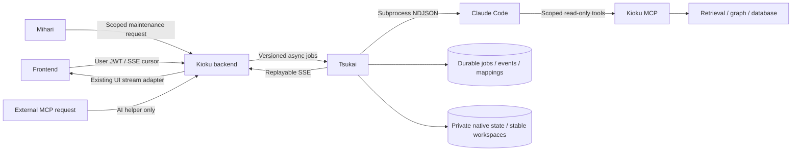

# Tsukai (使い): execution service design

Status: draft for user review. This document authorizes no production cutover. The implementation workstreams below are proposed assignments, not completed implementation.

## Purpose and boundaries

Tsukai is Kioku's asynchronous AI execution service. It owns native Claude Code processes and normalizes their events. Kioku continues to own identity, repository scope, retrieval, citations, conversations, briefing publication, and the web experience. Mihari continues to discover principal-branch changes, index code/graphs, select work, and apply validated maintenance results. MCP remains the knowledge/tool boundary; when an MCP request needs generative AI, it submits a typed Tsukai job.

The intended deployment is one independently deployed, nonroot Dokploy container, with bounded concurrent subprocesses. A container is not created per turn. Each native process belongs to exactly one conversation or maintenance job. A process is never multiplexed across users by changing an incoming native session ID.

This design covers chat, Mihari, MCP AI helpers, recovery, durable communication, deployment, and observability. It does not replace Voyage embeddings/reranking, turn database queries into model calls, or treat agent prose as verified repository truth. It introduces no automated Google-password login.

## Evidence and its limits

Evidence is the research-only [PR #203](https://github.com/felipemeriga/kioku/pull/203), commit `52599f7`. Source reports: [local RESULTS.md](https://github.com/felipemeriga/kioku/blob/52599f7/research/claude_code_poc/RESULTS.md) and [SERVER_RESULTS.md](https://github.com/felipemeriga/kioku/blob/52599f7/research/claude_code_poc/SERVER_RESULTS.md). That branch has not been merged as product code.

| Experiment | Observed result | Design consequence |
|---|---|---|
| Local evolving repository/chat soak | 10,800.011 monotonic seconds, 60 cycles, 569 one-shot calls across experiments | Native execution is feasible; tests are not a production reliability SLA |
| Persistent stream run | 10,800.540 seconds, 60/60 realistic architecture recalls, 3/3 forced worker replacements recovered | Persist session IDs/state, support explicit resume and process replacement |
| Whole-cycle correctness | 51/60 cycles passed every assertion; JSON prose, artificial identifier truncation/refusals caused remaining failures | Separate transport health, schema validity, and factual quality |
| Host and constrained server container | 6/6 checks each; 48 suite calls, 46 success and 2 deliberate cancellations | Dedicated container is viable; host broker remains an evaluated alternative |
| Actual Mihari fixture dispatcher/poller | 7/7 assertions across three real local Git remotes | Retain unchanged-HEAD gating, failure checkpoint retention, source validation |
| Production services in fixture | Supabase/KMS, uploads, embeddings replaced by isolated adapters | Full production tools, account isolation, load and publication still require acceptance tests |
| Container recreation | Conversation resumed in 2.62s with private state and stable cwd | Persist native state AND stable workspace mapping |
| Native stream input session ID changed | Process still used original conversation | One process per native conversation; never frame-level tenant routing |
| Simultaneous native resumes | Both could run; CLI did not enforce conversation locking | Application-level exclusivity is mandatory |
| Compaction | Approximately 132,887 to 39,879 tokens; unsupported earlier assistant details survived | Native memory is execution context, never authoritative repository evidence |
| Client disconnect | Completed answer retained after client received one character | Closing SSE detaches; cancellation is an explicit action |
| Free JSON | Trailing prose broke parsing; native JSON schema fixed format path | Strict schema plus semantic/source checks before publishing |
| Coding system prompt | Some fake tool XML, refusals, history confusion; grounded custom prompt improved small samples | Version task-specific Kioku prompts; do not assume default coding behavior fits chat |
| Maintenance thinking calibration | Six native Haiku cases: median 10.487s versus 4.936s with thinking disabled | Explicit per-task effort/thinking policy; measure quality before adoption |
| Session cost | Cumulative totals across turns/resumes, resets after crash | Durable per-call ledger and reset-aware accounting, not sum of native totals |
| Model aliases | Tested aliases resolved differently from production API IDs | Record served model and CLI version; pin tested model IDs |
| Missing/expired auth | `auth status` reported logged in while real inference failed | Separate cheap liveness from cached actual-model readiness |
| OAuth refresh lifecycle | Successful login/persistence/restart tested; actual expiry/automatic-refresh cycle not exercised | Native refresh is documented behavior, still a rollout test gap |
| CLI modes | `--bare` ignores subscription OAuth; safe mode omitted fixture MCP on tested version; turn budget 1 could end without answer | Pin/test launch flags, explicit tool configuration and terminal error handling |

The observed $4.7325434 local API list-price equivalent is not subscription billing or proof of savings. Local stateful/stateless comparisons were small samples, not an API-versus-harness benchmark. Server host/container resource limits differed, so their latencies are not an apples-to-apples architecture ranking.

## Evaluated architectures and proposed defaults

1. **Dedicated runner container, chosen proposal:** internal HTTP job API and replayable SSE, private persistent volumes, native subprocess per active job. It fits Dokploy and isolates model execution resources from API responsiveness.
2. **Host process and Unix broker:** worked in the POC, but adds host installation/service/account lifecycle and filesystem coupling. Retain only as a documented diagnostic alternative.
3. **Container per session/job:** stronger execution separation, but more orchestration, startup and volume lifecycle. Reserve for arbitrary code execution or distinct credential principals; no claim that subprocess separation is a hostile-tenant security boundary.

Proposed agentic/deep chat default is stateful explicit resume per Kioku conversation, one active turn at a time. The stateless mode remains a tested selectable execution policy with bounded server-supplied history. On missing native state, no silent switch: the backend may explicitly rebuild a new native session from canonical Kioku history, recording a new generation and explaining recovery. Mihari uses a NEW native session for every model call, including each selected section, review plan, learning batch and repair. A repository/pass groups these independent calls for checkpoints; it is not a shared native session. MCP generative calls follow the same rule. Plain chat uses a fresh completion session; only agentic/deep chat uses the Claude harness with explicit conversation resume.

Start with one runner replica and three concurrent Claude processes: two root jobs plus one reserved metadata child completion. Use a fair queue with at most one maintenance process so a maintenance backlog cannot consume both root slots; this is a proposed conservative default, not a measured maximum. Capacity and subscription quotas are separate constraints. A queued interactive job has a short admission deadline and visible queued status; it must not hang an HTTP worker.

## Non-negotiable invariants

- Backend authorization decides `user_id`, repository scope and conversation ownership. Client/model-provided identity never widens access.
- `conversation_id`, `turn_id`, `job_id`, `attempt_id`, native session ID and event sequence are different identifiers. Native IDs are opaque runtime metadata, never public authorization credentials.
- PostgreSQL holds durable accepted work, canonical messages, session mappings, events and publication checkpoints. Redis is a wakeup/cache/notification mechanism; its loss must not erase accepted work.
- Native state volume holds Claude's resume artifacts and is private to Tsukai. Kioku history remains durable product truth. Native transcripts are not automatically uploaded as learnings.
- No network/model/Storage call runs synchronously on the backend event loop. Consumers use asynchronous clients or explicit thread offload.
- No guarantee of exactly-once model inference: crashes can leave completion/billing uncertain. Idempotent acceptance and publication prevent duplicate product effects; they cannot eliminate all paid duplicate inference.
- Browser disconnect, backend stream reconnect and explicit cancellation are separate operations.
- Harness-origin search/graph tools run with AI enrichment disabled. Only the registered metadata SQL helper may submit a depth1 fresh tool-disabled completion through reserved capacity; every other nested AI submission is forbidden.
- Tokens, native credential files, raw authorization headers and Google credentials never enter logs, Git, public SSE, or model prompts.
- Subscription entitlement is checked independently of routing. A single operator subscription is not enabled as a shared multi-user billing pool. Account credentials must serve permitted use; broader deployment needs an eligible authentication/billing arrangement.
- No silent API fallback. Any permitted fallback is configured, budgeted, attributed, and visible.




## Authorities and durable records

Kioku Postgres remains authority for domain conversations/messages, repo briefing/learning facts, owner/folder authorization and accounting ledger. Tsukai has durable execution-control tables in Postgres (same physical service allowed), with narrow runner permissions; Redis can notify/wake workers but must not be sole job/event/session authority. Native state is a private persistent filesystem cache required for resume. Neither native history nor Redis overrides domain records.

Proposed records:

- `tsukai_sessions`: `id` UUID, owner_id, execution_principal_id, conversation_id nullable, mode (`resumable`/`stateless`), native_session_id UUID nullable, native_state_namespace, workspace_key, prompt_version, tool_policy_version, model_id, generation integer, status (`ready`,`active`,`needs_rebuild`,`retired`), last_committed_turn_id, created_at, last_used_at. Unique active mapping per owner/conversation/engine. Workspace path is derived server-side; callers cannot submit arbitrary paths/native IDs.
- `tsukai_jobs`: `id` UUID, caller_kind (`chat`,`mihari`,`mcp_ai`), parent_job_id nullable, root_turn_id nullable, parent_tool_call_id nullable, ai_depth (0 root/1 registered child), owner_id, folder_scope IDs, conversation_id nullable, session_id nullable, idempotency_key, request_sha256, operation, input_ref, state, result_ref, terminal_error_code, deadlines, cancel_requested_at, created_at/started_at/completed_at. Unique `(owner_id,caller_kind,idempotency_key)`. Same key with different canonical request digest returns409.
- `tsukai_attempts`: id, job_id, attempt_no, runner_instance_id, lease_generation/fencing_token, native_session_id, PID diagnostic only, native model/CLI versions, started_at, last_progress_at, finished_at, outcome, native_terminal_subtype, usage_status, accounting_segment. PID never constitutes ownership proof.
- `tsukai_events`: `(job_id,seq)` unique, attempt_id, event_type, payload_version, sanitized payload, recorded_at. Monotonic seq for entire logical job, including multiple attempts. Output and typed tool/progress events, not chain-of-thought or secrets. This is durable replay log; authorized by job ownership.
- `tsukai_commits`: unique job_id + domain_target/version; records backend acknowledgement of persisted assistant answer or repo update. Domain write has unique execution_job_id; an outbox item exists until result consumption is acknowledged.

Request payload/results may contain private documents: encrypted at rest using existing infrastructure, no raw prompt logging in standard logs. Credentials never in tables/events/prompts. Retention proposed: sanitized event replay 7days; full result follows conversation/repository retention; failed-attempt diagnostic metadata30days. Native session storage retained while mapped conversation active, then tombstoned/deleted with account/conversation deletion. Retention values are operational defaults, not POC findings.

## Admission and concurrency

Backend authenticates users; Tsukai accepts only authenticated internal service submissions with an immutable signed/bound owner/scope envelope. No model-supplied user_id or folder_id expands scope. One global bounded semaphore initially allows 3 native processes: at most 2 root jobs and 1 reserved metadata child; background maintenance uses at most 1 root job; queue fairness by owner and chat priority with aging to prevent Mihari starvation. These limits are conservative proposed defaults; POC fanout4 worked but did not establish production capacity.

Single active turn per native session/conversation enforced with durable lease and fencing token. Reject a distinct simultaneous chat turn409 `conversation_busy`; replay same idempotency key returns existing job. Lease heartbeat every5seconds, expiry30seconds. Losing the lease terminates the local process group; a successor cannot start on the same native session until predecessor termination is confirmed or session is quarantined. Fencing alone cannot stop two local processes writing one native transcript. Initially only one active runner instance owns the native-state volume; multi-replica scheduling needs explicit volume/session affinity and must not just mount one writable volume everywhere.

## Job and attempt state transitions

`queued → starting → running → completing → succeeded`.

Other transitions: queued→cancelled; starting/running→cancel_requested→cancelled; starting/running→retry_wait→queued for provably safe failures; starting/running→blocked_auth or blocked_capacity; starting/running→interrupted_uncertain; completing→succeeded after result durability. `failed` is terminal for validation/policy/model-output failure after allowed repair budget. Backend result application tracked separately via commit acknowledgement, so generation success is not equivalent to briefing write success.

On admission persist job before response202. On claim persist attempt and ownership before process start. Persist desired native_session_id BEFORE the first CLI invocation using supported --session-id; compare observed init/result session ID to mapping. A mismatch quarantines attempt as protocol error, never silently remaps another conversation. Persist terminal result/events before releasing session lock. Stateless mode uses --no-session-persistence and never permits resume.

At most one terminal event per logical job. State transitions and terminal event/outbox insert are transactional and use current fencing token. Terminal result plus exit0 required for native success; neither alone suffices. Exit0 without terminal event is protocol failure; result followed by abnormal exit is preserved for reconciliation instead of thrown away.

## Retry policy and ambiguous completion

Exactly-once paid inference cannot be promised. Idempotent admission and domain commit prevent duplicate visible messages/writes, not provider execution charges.

- Before process start: connection/lease/storage failure may retry at1,2,4seconds plus jitter, max3attempts.
- Native startup transient/network/provider overload with explicit terminal retryable error and no user-visible output/side effects: bounded retry with provider retry-after; do not exceed job deadline.
- Authentication rejection: no hot restart loop; block credential principal, preserve queue, one operator alert; readiness probe after credentials restored unblocks. Subscription quota: block until retry-after/reset or operator action, no API fallback without configured consent/budget.
- Structured output validation: one bounded repair as a NEW attempt and NEW native session inside the same logical job, referencing invalid response and schema; save both attempts/usage. Semantic source validation failure must not publish invented facts. Exhaustion fails job and retains previous repo state.
- EOF, killed process, lost worker or network after invocation with no durable terminal result: `interrupted_uncertain`. Do not blindly repeat the original prompt via --resume because it might already exist in native transcript. Preserve partial output separately, quarantine that native generation, and offer/perform an explicitly recorded fresh-session reconstruction from committed Kioku history for a new turn attempt. Any automatic retry must be operation-declared safe (read-only generation), use a fresh native generation, record possible duplicate inference and never repeat domain writes. A transcript parser recovery could be implemented later, but requires version-tested evidence and must not be assumed from the POC.
- Missing/corrupt native session: rebuild only from committed Kioku messages/context into a NEW native_session_id with incremented generation, emit context_rebuilt; never resume another user/session or claim compacted state was recovered.

Mihari's target key includes owner/repo/head_sha/operation/prompt-policy version. Repeated same-head jobs reuse stored result when valid. Reviewed HEAD advances only after ALL selected section results are validated and backend writes acknowledged. A failed section leaves overall review incomplete; retry can reuse already validated outputs and resume outstanding operations, without marking fresh while no update committed. Per-repository pass serialization prevents stale commits: backend conditional apply compares expected reviewed/source HEAD and new git target; an obsolete pass cannot overwrite newer facts.

## Timeout/cancellation/restarts

Suggested configurable defaults: queue deadline chat30s/background30min; first native event timeout30s; progress inactivity120s; chat wall timeout300s; maintenance operation wall timeout300s, repository pass15min; max native tool rounds 8 for agentic chat; completion profiles have no retrieval tools. These are design bounds, not measured guarantees. Compaction can pause text but typed progress/heartbeat continues; no-token-timeout is not a valid kill criterion alone.

Explicit cancellation is distinct from HTTP disconnect. Cancel API persists request, sends SIGTERM to dedicated process group, waits5s then SIGKILL, reaps children, writes cancellation terminal event. Cancellation does not undo an already accepted result/domain commit; idempotent cancel returns current terminal state. Native partial state after cancelled turn is quarantined or version-tested reconciled before next resume. Browser disconnect simply detaches subscriber; generation proceeds.

Dokploy SIGTERM: runner stops admission/claims, advertises draining, continues active work during configured grace period (120s, with Docker stop_grace_period150s), then cancels remaining groups and marks interrupted_uncertain durably. Restart scans unacknowledged completing jobs/outbox, delivers saved results without new inference; expired active leases reconcile as uncertain. Native-state mount and stable absolute workspace survive container recreation; never delete them as temp cleanup.

## Streaming/reconnection semantics

Each normalized event contains `protocol_version`, job_id, attempt_id, seq, type, timestamp, payload. Durable append before delivery. Batch text deltas at up to250ms or16KiB to avoid per-token Postgres writes; SSE chunks reflect these persisted batches. Redis/pubsub is wakeup only; after notification consumers read durable seqs. Preserve native typed tool and assistant message identities to avoid duplicating assembled assistant content after partial deltas.

Backend subscribes with last_seq cursor; browser SSE uses event id job_id:seq and reconnect Last-Event-ID (or explicit cursor if POST/fetch SSE). A disconnect/reconnect attaches to same job and cannot resubmit inference. Gap/dedup behavior: ignore seq<=last_applied, fetch next contiguous seq; if replay retention expired return410 `replay_expired` plus canonical result/status URL and frontend reloads durable answer. Slow consumers do not block process stdout drainage; bounded in-memory buffers spill to durable events. If durable event persistence fails, stop advertising unpersisted output and fail/degrade explicitly; never claim replayability for lost chunks.

Normalize public event classes: accepted/queued, started, progress, tool_started/tool_completed (sanitized), assistant_delta scoped to message_id/channel, citations, usage, context_compacted/context_rebuilt, completed, failed, cancelled. Native hidden reasoning is excluded. Native pre-tool prose belongs to progress/activity, final answer to canonical assistant message; final classification may require retraction/replacement or per-message UI channels rather than naïvely concatenating all text. Parent protocol spec must define exact mapping. Completion carries result checksum/ref and assistant message ID; backend persisted domain answer is reload source.

## Accounting integrity

Record requested and served models, native session generation, attempt ID, per-turn usage (base/cache read/cache writes/output), cumulative native counters and reset detection, list-price equivalent vs subscription charge clearly separated. Segment cumulative totals whenever decreasing or process recovery starts a new baseline; serialize turns so deltas are attributable. Missing terminal usage flagged incomplete/unknown, never0cost. Do not sum per-turn total_cost_usd across a resumed session. Counter reset can occur without losing memory. Existing backend services/usage_ledger.py must accept engine/provider kind and usage confidence without discarding raw sanitized counters.


## Private API v1

All requests use JSON UTF-8, UUID identifiers, UTC RFC3339 timestamps, `Content-Type: application/json`, and `X-Request-ID`. Backend/MCP use separate rotatable service credentials in `Authorization: Bearer <service-secret>` over the private network; raw service secret is never passed to the model. Tsukai authenticates service identity and allowed task classes before parsing untrusted content. Outbound user/repository scope is an authorization capability minted after backend's existing ownership checks. Model arguments cannot select tenant identities.

`POST /v1/jobs`, `Idempotency-Key: <stable request UUID>` returns 202 with `{job_id,status,events_url,result_url}` after durable admission. Same caller, tenant and key with identical canonical request returns existing job; differing request returns 409 `idempotency_conflict`. A queue rejection returns 429 with `Retry-After`, without a native process being created. Admission does not claim that model output will succeed.

```json
{
  "protocol_version": 1,
  "task": "chat.agent_turn",
  "tenant": {"user_id":"uuid", "scope_folder_id":"uuid"},
  "request_id":"uuid",
  "conversation_id":"uuid",
  "turn_id":"uuid",
  "session_policy":"resume",
  "input": {"user_message":"How does upload retry work?", "history_revision":12},
  "policy": {"model":"claude-sonnet-4-6", "effort":"low", "thinking_tokens":0, "max_turns":6, "deadline_seconds":180},
  "tool_capability_ref":"opaque-scoped-reference",
  "prompt_version":"chat-v1",
  "toolset_version":"kioku-read-v1"
}
```

Server resolves native session ID from durable mapping; callers cannot inject `--resume`, cwd, shell commands, arbitrary environment, MCP URL, command-line flags or service secrets. A configured model allowlist resolves aliases before spawning and records the served model independently. Numeric bounds in a request can only lower admin defaults. Native output token and context controls may not match Anthropic API parameters exactly; unsupported controls fail validation rather than being silently ignored. Initial proposed per-task deadlines/budgets are deployment knobs, not POC capacity conclusions.

Completion tasks have no autonomous tool loop: `task=completion`, logical `operation=query_rewrite|multi_query|text_to_sql|contextual|image_ocr|eval_judge|...`, `session_policy=fresh` for EVERY call and repair, approved system/user payloads and optional registered output schema. They disable MCP/native filesystem/shell tools, use a concise Kioku system prompt and a small native turn allowance sufficient for the chosen structured-output mechanism. Do not assume `max_turns=1` works with MCP: POC exhausted its budget before answer. Image/OCR payload parity requires explicit supported-image tests before routing those operations.

Every Mihari call has `session_policy=fresh`, no `--resume`, and no persistent idle native process. Mihari requests use `task=mihari.review_plan|mihari.activity|mihari.section|mihari.documentation|mihari.learnings`, `repo_id`, `head_sha`, `base_reviewed_sha`, `section`, source snapshot references/hashes and fixed schemas. Backend validates schema and cited source paths after native schema output; JSON syntax alone did not prove factual correctness in the POC. The backend publishes only if the expected repository SHA/current section revision still match; stale completed work is recorded, not blindly published. Unchanged HEAD gating remains before model admission.

`GET /v1/jobs/{id}` returns status, timestamps, attempt count and sanitized error. `GET /v1/jobs/{id}/result` returns 202 while active, 200 terminal envelope once terminal. `POST /v1/jobs/{id}/cancel` is explicit user cancellation and returns current state; disconnecting from events does not call it. `GET /v1/jobs/{id}/events` provides resumable SSE. `GET /health/live` checks process/service only; `GET /health/ready` exposes cached queue/storage/auth availability, not an unconditional paid inference. Use real model readiness only at startup/recovery or after relevant failures with throttling.

## Durable event protocol

Each event is persisted before publication, with monotonically increasing integer `seq` per job across all attempts. SSE `id` is `<job_id>:<seq>`; consumers send `Last-Event-ID` or `after_seq`. At-least-once delivery is explicit; consumer deduplicates by job/seq. Native message IDs and event UUIDs are metadata, not substitutes for our sequence. A subscriber receives replay then live events without a read/subscribe gap. Slow consumers do not backpressure the native stdout pipe; bounded delivery buffers detach slow subscribers, which can reconnect. SSE emits a comment heartbeat every 15 seconds. Nginx disables response buffering and uses an idle timeout above heartbeat spacing. If requested events have expired, return 410 `replay_expired` with the status/result URL; never rerun inference to reconstruct deltas.

```text
id: 2a...:17
event: text.delta
data: {"protocol_version":1,"job_id":"2a...","attempt_id":"uuid","seq":17,"occurred_at":"2026-11-04T01:00:00Z","payload":{"message_id":"uuid","segment_id":"s3","text":"Uploads retry","provisional":true}}

id: 2a...:25
event: answer.completed
data: {"protocol_version":1,"job_id":"2a...","attempt_id":"uuid","seq":25,"occurred_at":"2026-11-04T01:00:02Z","payload":{"message_id":"uuid","answer":"Uploads retry … [1]","citations":[{"id":1,"source_id":"chunk-id","path":"backend/services/upload.py","line":42}],"finish_reason":"success"}}
```

Event vocabulary: `job.accepted`, `job.started`, `session.bound`, `stage.changed`, `text.delta`, `segment.completed`, `tool.started`, `tool.completed`, `citations.updated`, `usage.updated`, `answer.completed`, `job.completed`, `job.failed`, `job.cancelled`. Unknown optional event types are ignored by v1 consumers; incompatible schema changes require v2. No raw chain-of-thought/thinking deltas, tool credentials, native configuration initialization dumps or raw stderr are forwarded to UI. Error text is sanitized with a correlation ID for private diagnostic logs.

Native partial text can be investigation narration before tool calls; a streamed segment is provisional until the assembled assistant message proves it is a final answer. Normalize native message/segment IDs and stop reason, show research text only as progress while provisional, and commit/render answer text when appropriate. `answer.completed` contains authoritative final text and replaces any provisional rendering for that attempt. The current frontend stores only final answer content; preserve that semantic. Whether UI should display provisional prose in a collapsible progress block is a presentation choice; final text streaming without any buffering cannot be guaranteed before native stop intent is known.

The backend bridges normalized Tsukai events to existing SSE payloads (`token`, `stage`, `citations`, `debug`, `error`, `done`) during migration, plus turn/job IDs and resumable SSE ids. Current `frontend/src/lib/api.ts::streamChat` treats a missing `done` as failure; retain that requirement and teach it reconnection/deduplication. Backend recovery workers, not the browser SSE request handler, must finalize messages from terminal jobs. Persist one assistant message per turn/job with a uniqueness constraint. A native terminal result is necessary but not sufficient: successful product delivery requires persisted final result, validated structure and backend publication; Tsukai generation success is tracked separately from the backend commit acknowledgement; process exit 0 without expected terminal data is `protocol_incomplete`.

## Tool/MCP routing and recursion

External MCP AI operations submit fresh Tsukai completion jobs. Harness-origin search/code/graph tools use deterministic scoped retrieval with query rewriting and multi-query AI disabled; Claude's main harness can reformulate its queries. Embeddings/reranking retain their provider paths.

Preserve the natural-language `query_documents_metadata` tool via exactly one registered child operation, `text_to_sql`. It runs a NEW tool-disabled native session with `parent_job_id`, `root_turn_id`, tool-call correlation, depth1, and the parent's remaining deadline. It cannot invoke MCP, submit another child or widen scope. The capability separately grants this exact operation; generic retrieval capabilities remain depth0. Scheduler reserves one process slot for these children in addition to two root slots; external root jobs cannot borrow it. At most one child per parent may be outstanding. Wait at most10seconds for child admission, then return a typed tool error; child execution deadline is min(60seconds,parent remaining time). Parent cancellation revokes/cancels children. All child calls are separately attributed to the root chat turn. Full parent occupancy must never block the reserved worker from making progress.

The backend validates generated SQL using its existing read-only query protections, allowed relations and server-bound owner/scope; model text cannot bypass database authorization. Query-plan results and final rows appear in Inspect with SQL/error redaction as needed. A deterministic metadata query interface remains an evaluated simpler alternative, but this draft chooses the bounded child lane to preserve the existing natural-language tool contract. No MCP path may bypass Tsukai to call direct Claude inference as a recursion escape hatch.

## All generative callers and accounting

Central `services/llm.py` becomes a provider-neutral execution facade with typed normalized text/structured results, not an Anthropic Message object emulation. Audit current call sites: `services/rag.py` (chat/evaluation loops), `services/query.py`, `services/contextual.py`, `services/parser.py`, `services/text_to_sql.py`, `services/repo_learnings.py`, and `routes/mihari.py`. MCP paths use the same facade. Tests/eval must select the same harness/parameters as production to avoid a different evaluation loop. Existing eval default may remain explicitly API-backed during migration, recorded as such; do not call it a test of Tsukai until routed.

Use `job_id`, `attempt_id`, `turn_id`, native session ID, native assistant message ID and model ID as distinct ledger fields. Report transport/harness execution cost as native list-price equivalent with accounting source/precision fields; it is not subscription cash spend. `total_cost_usd` and modelUsage were cumulative across normal resumes and reset on crash; persist counter segments and delta only within known monotonic segments. A reset, missing final record or overlap is recorded as incomplete/unknown, never zero. Do not sum cumulative result totals; do not combine API-equivalent costs with actual API billed estimates as if they were the same charge. Record per-turn token categories and per-model usage when supplied, native helper/subagent coverage caveats, latency and quota/error signals. Resolved model/version and thinking settings are required because aliases drifted and disabling unnecessary thinking materially affected POC results.

Errors carry `{code,retryable,retry_after_seconds,completion_certainty,correlation_id}`. Codes include `auth_required`, `quota_exhausted`, `rate_limited`, `queue_full`, `session_busy`, `session_unavailable`, `deadline_exceeded`, `native_crash`, `protocol_incomplete`, `tool_failed`, `invalid_output`, `model_unavailable`, `stale_source`, `nested_ai_forbidden`. No automatic API fallback: a configured fallback is a new attempt with explicit provider/billing attribution. Retry scheduling and uncertain paid-inference recovery belong to the runtime state machine; do not replay a completed tool/write or native prompt merely because an HTTP response was lost.


## Image and filesystem contract

Proposed files: `tsukai/Dockerfile`, `tsukai/pyproject.toml`, `tsukai/uv.lock`, `tsukai/src/tsukai/*`, `deploy/hive/kioku/tsukai/docker-compose.yml`. New image `felipemeriga1/kioku-tsukai:<semver>-<sha>@sha256:<digest>`; pin native CLI version and image digest. Initially2.1.285 matches successful POC; upgrade only through compatibility matrix, not implicit auto-update on startup. Native binary means Node runtime is unnecessary. Official installer fetched only at image build; never at request time. Preserve an official unmodified binary; record version in startup metadata and each attempt.

- UID/GID1000, `read_only:true`, `restart:unless-stopped`, `init:true`, `pids_limit:128`, initial memory2GiB/CPU2 (headroom for two root jobs plus one bounded child; verify before rollout; tune after load test), cap_drop ALL, no-new-privileges. These defaults need a real max-context/fanout acceptance run.
- Persistent private named volume `tsukai-state:/state`, `CLAUDE_CONFIG_DIR=/state/claude/<credential_profile_id>`; volume `tsukai-data:/data` for stable workspaces, attempt scratch and durable spool. Paths from validated server-owned IDs only; no caller-controlled filesystem path or native CLI flags.
- Stable workspace `/data/workspaces/<owner_id>/<session_id>` stored in session row; directory0700. Separate session scratch directories. For Mihari, immutable/read-only source snapshots mounted/staged per job; native permitted tool set determines whether shell/file access exists. Unrestricted shell tools require stronger per-job OS isolation before rollout; separate processes are not a security boundary.
- tmpfs `/tmp`128MiB and `/home/runner`32MiB, appropriate uid/gid; bounded stdout/stderr/event spool and temporary source retention. Do not mount Docker socket, host root or backend service-key files. No production credential file shared with backend/MCP/Mihari.
- Backups must include native transcripts/config and job/session mappings as a consistent recovery set; native auth secrets require encrypted restricted backup or reprovisioning, not generic document Storage. Restoring DB mappings alone cannot resume a missing native transcript. Initial single-host volume does not provide host-failure HA; document this limit explicitly.

## Authentication provisioning and rotation

Existing storage locations verified in prior operations: server `/root/.config/kioku/runner/.env`0600 in0700directory, and Dokploy Kioku production environment variable `CLAUDE_CODE_OAUTH_TOKEN`. The spec must never include its value. Existing app containers do not currently receive it. Inject explicitly only into Tsukai's designated profile configuration; do not assume a Dokploy environment variable automatically reaches a service.

For initial personal profile, use the operator-provisioned setup token as the explicit auth mode. Ordinary native-login credentials are an alternative mutually exclusive profile mode; initialize through official browser flow within the persistent native config volume. Never copy Mac credentials. Set `auth_mode` and `credential_version` in profile metadata, plus operator-recorded `issued_at`/`expires_at` when known. Do not claim token expiry was parsed or verified if not known. Service credential for Backend↔Tsukai is a different secret (`TSUKAI_SERVICE_TOKEN` or signed job capability); never reuse Anthropic OAuth token for interservice auth.

Spawn children with a sanitized allowlist: HOME/CLAUDE_CONFIG_DIR/PATH/locale, configured OAuth variable for the selected profile, required proxy/CA variables only. Strip ANTHROPIC_API_KEY, ANTHROPIC_AUTH_TOKEN, ANTHROPIC_BASE_URL, api-key-helper settings, Bedrock/Vertex/Foundry flags and inherited AWS/cloud credentials unless profile explicitly selects that provider. Controlled settings/hooks/MCP configuration; no arbitrary cwd discovery. Normal `-p --output-format stream-json` with supported controls, not `--bare`/safe-mode that removed required auth/MCP in POC. Inspect initialized served-model/credential-source metadata and fail closed on an unexpected provider; redact initialization metadata before durable/public events.

Rotation: operator generates replacement through official flow, updates private file and Dokploy secret, increments credential version, starts drain, waits active jobs or bounded deadline, recreates runner, performs one actual tiny-model readiness probe and one scoped MCP test, then reopens queue. A running container's environment does not update merely because Dokploy secret changed. Keep old secret only for tightly scoped rollback until verified; never print it or send it to UI. Alert at 30/14/7 days before known expiry and immediately on terminal auth failure. No promise token renewal itself can extend a one-year setup token indefinitely.

## Health and failure policy

`GET /health/live`: process/event-loop health only,200 within100msunderload; Docker healthcheck30s/3s/retries3, zero model calls.
`GET /health/ready`: cached structured state, credential profiles' sanitized availability, queue/drain state and last verification timestamp; no model request per HTTP probe. HTTP503 for unable-to-admit,200 for accepting. A tiny model call at first provision/startup after credential change or explicit recovery verifies actual auth. Healthy recent real requests refresh verification; no repetitive paid idle probe. Startup probe singleflight per profile,45sdeadline; prevent restart loops from launching many probes.

State taxonomy: `healthy`, `probing`, `refresh_in_progress`, `reauth_required`, `quota_wait`, `provider_degraded`, `draining`. Match native typed events/errors first, versioned sanitized patterns second, unknown errors remain unknown. Terminal auth failure opens per-profile circuit, stops admissions and alerts once; queued jobs remain durable, chat receives immediate recoverable status rather than hangs. No completion markers or Mihari reviewed SHA advanced on such failure. Native refresh contention/network failure bounded backoff with jitter; do not spawn repeated login attempts. Quota wait records provider retry/reset when available, never invents an allowance reset time. Expired job deadlines become explicit terminal state rather than queue forever.

API fallback default OFF. If admin enables it, credential profile, allowed tasks, monthly/daily budget and max attempts explicit; record a new attempt with provider/billing source and notify frontend of fallback. Never change billing silently. A partial/uncertain native attempt must not be blindly repeated on another provider. Durable retry/reconciliation is defined by job protocol, not Docker restart policy.

## Observability and accounting

Correlate owner_id, credential_profile_id (opaque), conversation_id/session_id, job_id, attempt_id, native_session_id, deployment_sha, CLI version and actual model. Logs never contain credentials or unrestricted native initialization dumps. Restrict raw transcripts/tool outputs; operational logs use event kinds/counts/errors. Record queue wait, first token, generation time, tool latency, event persist lag, replay count, cancellations, recovery, retry/auth/quota states, memory/CPU/open processes.

Per provider message usage deduplicated; capture uncached input, output, cache writes byTTL and cache reads. Keep raw native session total as diagnostic with counter_epoch; never sum cumulative result totals across resumed turns. Detect counter decrease and record reset without negative spend. Missing final usage after a crash is incomplete/unknown, never zero. Account usage is quota-based; list-cost equivalent must not be shown as actual subscription spend. Existing Kioku usage admin owner/source/repo attribution remains; show native execution source and completeness. Operator quota snapshots from shared account cannot attribute percentage consumption exactly to Kioku. Billing authoritative reports separate from model-list estimates.

## Release integration

Current `scripts/release/release.py` PACKAGES lacksTsukai and affected() maps backend→backend/MCP. Add Tsukai package/version manifest/build mapping, Dockerfile/context, and corresponding unit tests. Add `tsukai` image/service to `.release/versions.json`, image digest validation, narrow Hive compose patching and `scripts/release/deployment.py` affected service mapping. Add Dokploy compose ID to DOKPLOY_COMPOSE_IDS and keep secret out of Git. Release prepare must verify ID/deploy history, validate image and exact promoted commit as existing pipeline does. Tsukai-only changes must not rebuild unrelated frontend/CLI; shared protocol changes identify impacted consumers explicitly.

Deploy runner first with feature routing OFF. Verify liveness/auth/scoped tool call/queue persistence against fixtures. Deploy backward-compatible backend/MCP/Mihari clients with provider switch default API. Enable personal owner pilot for chat, then maintenance, then other AI tasks only after acceptance. Rollback routing to prior API provider is explicit admin action, with billing notice and budget. Preserve native session mappings even when routing off. Do not downgrade native binary against live writable state without snapshot/compatibility check.

Graceful SIGTERM: ready=false, stop admissions, persist drain marker, finish active jobs for configured grace (proposed120s), preserve events and results, then cancel/mark interrupted remainder; Docker stop_grace_period150s. New container waits predecessor lease expiry/reconciliation before accepting same session. No concurrent write access to same native state/session by two deployment replicas. Start-first overlap requires coordination; simplest initial deployment stop-old/drain-then-start-new. One replica only until lease fencing and shared-state semantics are verified.


## Binding execution profiles and completion detection

This section incorporates the user's explicit fresh-call requirement and takes precedence over any general session discussion above.

| Profile | Native lifecycle | Tools | Product completion |
|---|---|---|---|
| `chat.agent_turn` in agentic/deep mode | New process each turn; explicit conversation resume; idle process exits | Scoped Kioku read tools; harness owns reasoning rounds | Final answer or a normal conversational clarification shown in chat |
| Plain chat | Fresh session per call with supplied bounded history | No autonomous tool loop; deterministic retrieval supplied by backend | One final answer |
| MCP AI helper | Fresh session for EVERY call/repair, no resume or waiting for user input | No interactive/native tools; typed supplied context | Valid typed result or `needs_input`/error returned to MCP caller |
| Mihari operation | Fresh session for EVERY review/section/documentation/learning call/repair | Supplied immutable source/context; no interactive tools or autonomous writes | Validated typed result, including legitimate unchanged/insufficient-evidence outcome |

Completion processes use supported one-shot `-p` invocation, no TTY, closed stdin after the one request, strict output schema, disabled hooks, disabled `AskUserQuestion` and native shell/write tools. Native `result` is a candidate terminal envelope. Mark inference succeeded only after decoding the full terminal record, validating task output, and reaping the process with expected successful exit. Text silence, a heartbeat, an assistant message ending, or HTTP EOF alone is not completion. A result followed by nonzero exit is retained for reconciliation. Exit without a result is explicit `protocol_incomplete`. Never wait indefinitely for a question to be answered through stdin.

For machine consumers, normalized outcome is `completed`, `needs_input`, or `failed`; task data may include `disposition=updated|unchanged|insufficient_evidence`. A `succeeded` execution job means a valid terminal envelope was durably produced, not that its content is publishable. Its `semantic_outcome` persists separately as completed/needs_input/failed. The domain reconciler publishes only outcome completed with an allowed disposition; needs_input/failed records a bounded user/tool error or blocked review without applying facts or advancing review SHA. The operation registry provides the corresponding strict schema and task-specific validation rules. `needs_input` includes a sanitized question and explicit missing fields. MCP returns that structured outcome to its caller; it can ask its own user and submit a separate NEW call. Mihari records blocked/incomplete review and retains prior facts/checkpoints; it does not invent an answer or advance the reviewed HEAD. A correctly grounded `unchanged` result can acknowledge a reviewed section without rewriting it. Structured output cannot prove that all natural-language questions have been detected: fixtures must cover responses that contain a question despite claiming `completed`, and semantic validation must reject known task violations.

Clarification is a product outcome, not a stalled process. Human interactive prompts/permission denial events are unsupported for unattended profiles and return typed `interaction_required`; they never open a shell or automate an answer. Agentic chat may ask a question as its final message and await a new UI turn, which resumes its conversation normally.

## Complete authority and recovery contracts

All policy values here are proposed configuration defaults. Final acceptance may lower concurrency or change deadlines based on measured maximum-context behavior; tests must record the actual values used.

| Setting | Initial value |
|---|---|
| Runner replicas / total concurrent native processes | 1 / 3 (2 root + 1 reserved child) |
| Concurrent maintenance jobs / queue capacity | 1 / 100 |
| Chat queue deadline / maintenance queue deadline | 30s / 30min |
| First native event / inactivity / chat wall limit | 30s / 120s / 300s |
| Per-maintenance-operation / repository-pass wall limit | 300s / 15min |
| Lease heartbeat / expiry | 5s / 30s |
| SIGTERM process grace / deployment drain / Docker grace | 5s / 120s / 150s |
| Durable text batching / SSE comment heartbeat | Up to 250ms or 16KiB / 15s |
| Event replay retention / failure metadata retention | 7days / 30days |
| Automatic repair after invalid output | At most 1, in a fresh native session |
| API fallback | Off |

Service identity alone cannot choose arbitrary tenant scope. Backend issues a short-lived capability bound to `issuer`, `audience`, `owner_id`, allowed folder IDs, `job_id`, `attempt_id`, tool allowlist, `ai_depth=0` for root tool grants, expiry and nonce. MCP validates the capability against an active attempt and current ownership on every tool call. Use a dedicated signing key with rotation and audience checking; never reuse Claude OAuth or the client service secret. For the metadata exception, only backend may mint a derived depth1 child grant bound to parent/root/child IDs and exact `text_to_sql` operation; it has no MCP/tool permissions, cannot delegate again and cannot widen owner/scope. Grant lifetime is capped by attempt deadline plus30seconds. Cancel/completion revokes the grant server-side. Tsukai obtains it through a private authenticated backend endpoint after durable job admission; `tool_capability_ref` is an opaque reference, not a user-provided MCP URL. MCP configuration and native init output containing headers must be redacted before any logging/event publication.

Result consumption must survive backend restarts: a backend reconciliation worker scans successful jobs without commit acknowledgements and transactionally writes the domain message/result with unique `execution_job_id` or `(turn_id, role)`. It then acknowledges the durable Tsukai result. Review-marker and section CAS writes must be performed in the same authoritative DB transaction or tracked explicit per-section acknowledgements; an HTTP200 alone is not a publication checkpoint. A completed old pass whose expected source HEAD or section revision changed becomes `stale_source`, never an overwrite. Repository reviewed HEAD moves only when every required selected/reviewed operation has a validated acknowledged outcome.

DB loss after job acceptance pauses dispatch; Redis recovery reconstructs runnable work from DB. Running native stdout continues to drain into a bounded private spool while event persistence is retried, but no unpersisted delta is advertised as replayable. Cap per-attempt spool16MiB and per-subscriber delivery buffer1MiB; exceeding either detaches a slow subscriber or terminates an overflowing attempt with an explicit error. A crash with only spooled/unacknowledged output remains uncertain; private spool is not a substitute for committed event sequence. No accepted work depends exclusively on an HTTP connection or in-memory queue.

An uncertain turn is not silently replayed through the same native session. Mark its generation `needs_rebuild`, preserve incomplete text separately, and create a new native generation from committed Kioku history only through recorded recovery policy. This can incur duplicate inference and must appear in usage/retry records. Recovered work cannot replay domain writes, execute arbitrary code, or claim exactly-once provider billing.

## Parallel implementation ownership and ordering

These are proposed implementation assignments after spec approval. With the current tooling, run at most three workers at a time plus the coordinator. Each uses its own worktree and PR; contracts are reviewed before dependent agents start. Every PR uses a merge commit after CI passes. This draft itself is a documentation PR, not permission to deploy the runtime.

| Wave / agent | Owned files or boundaries | Dependencies / deliverable |
|---|---|---|
| 0 — coordinator and protocol reviewer | This spec, versioned JSON schemas, fixture event examples | Resolve ambiguities, approve design, establish request/result/event/error schemas before parallel edits |
| 1A — durable state | New `supabase/migrations/*_tsukai_execution.sql`, `tsukai/src/tsukai/store.py`, state/lease/idempotency tests | Jobs, attempts, sessions, events, outbox/ack, constraints, roles and retention; stable repository API for other agents |
| 1B — native adapter | `tsukai/src/tsukai/native.py`, `profiles.py`, `prompts/`, native contract fixtures | Typed NDJSON decoder, environment allowlist, supported CLI flags, schemas, fresh/completion vs resumed harness, no DB ownership overlap |
| 1C — consumer inventory | `backend/services/ai/` client facade and explicit task registry; migration tests | Typed results independent of Anthropic objects, all generative caller inventory, no direct bypass, capability contract agreed with coordinator |
| 2A — scheduler/runtime | `tsukai/src/tsukai/{app,scheduler,worker,recovery}.py`, process control tests | Depends on1A/1B; HTTP admission, locks, fairness, retries, cancellation, drain, auth circuits and bounds |
| 2B — backend/Mihari/MCP | `backend/services/rag.py`, `llm.py`, query/contextual/parser/text_to_sql/repo_learnings, `routes/mihari.py`, `mcp_server.py`, Mihari client | Depends on1C and contracts; current domain behavior, per-call fresh maintenance, scoped retrieval/debug instrumentation, recursion guard, publication CAS |
| 2C — image/release | `tsukai/Dockerfile`, package/lockfiles, `deploy/hive/kioku/tsukai/docker-compose.yml`, release scripts/manifests/workflows | Depends on health/drain contract; separate pinned image, scopes/env/volumes, affected-service builds, no secret in image/Git |
| 3A — frontend stream/debug | `frontend/src/lib/api.ts`, chat hooks/components and Inspect UI | Depends on protocol/backend; resume cursors, provisional/final segments, progress/provenance, cancel/reconnect/expired replay states |
| 3B — accounting/auth operations | `backend/services/usage_ledger.py`, usage routes/admin UI, credential-profile readiness/rotation operations | Depends on runtime IDs; subscription-equivalent vs API costs, reset/missing counters, alerts and explicit fallback budget |
| 3C — independent acceptance | Integration/chaos/eval fixtures and rollout report | Depends on all above; no feature code ownership, reproduces POC failures and validates end-to-end staging deployment |

Do not have multiple agents edit the central protocol or `services/llm.py` concurrently. The coordinator maintains schema compatibility, resolves shared-file changes, reviews independent acceptance evidence and decides pilot progression. Detailed step-by-step implementation plans follow user approval of this spec under the Superpowers writing-plans workflow.

## Required end-to-end acceptance before enabling traffic

1. Submit duplicate identical requests concurrently: one accepted logical job, no extra provider start; changed payload under same key conflicts. Cross-owner requests fail before a process starts.
2. Chat resumes correct session across process and complete container replacement with stable cwd. Missing/foreign/corrupt state produces explicit rebuild/error, never another conversation's context.
3. Two simultaneous turns in one chat serialize/reject; different conversations proceed independently within limits. A forged native input session ID cannot switch a worker's conversation.
4. Backend/frontend disconnect and restart after each persisted event boundary: reconnect gets contiguous deduplicated replay and one canonical final message. Browser disconnect does not cancel. Explicit cancellation reaps descendants and records partial/uncertain state.
5. Kill runner after native completion but before backend commit: reconcile without new inference or duplicate publication. Kill before terminal result: retain uncertainty, no blind same-session replay and no stale review marker.
6. MCP native retrieval returns tenant-scoped real Kioku documents/code/graph with traceable provenance. External MCP AI reaches Tsukai, while harness-origin search/graph make zero nested generation calls; metadata permits only its registered depth1 child, tested with both root slots occupied.
7. Every MCP/Mihari model call and repair gets a fresh native session. Inject assistant questions, permission prompts, invalid JSON, invalid enum, unsupported path and absent deployment evidence: bounded terminal outcomes, no indefinite input wait or fabricated publication.
8. Mihari unchanged HEAD creates no unnecessary AI work; changed HEAD reviews all appropriate sections. Failed/blocked section retains prior content and incomplete checkpoint. Successful unchanged content records review time; older results cannot overwrite a newer revision.
9. Debug Inspect reconstructs actual searches/scopes/source IDs/retrieval stages/tool errors across multiple rounds; cited sources match authoritative retrieval records. No hidden reasoning or credentials reach UI/logs.
10. Inject auth rejection, quota limit, provider timeout, refresh contention, output overflow, DB/Redis loss and expired replay cursor. Verify documented state, bounded retry, visible recovery and no unapproved API billing fallback.
11. Counter increase/repeat/reset, missing final record, multiple models and retry repair produce attributed list-equivalent usage with completeness flags. No sum of cumulative native session totals, no unknown spend shown as zero.
12. Dokploy rollout drains old process ownership, resumes from private volumes, pins CLI/image/version, uses no public port, keeps health responsive under chat+Mihari load, and rolls back routing without deleting canonical history/native mappings.
13. Run same actual model, thinking settings, questions and production tool access on current API and Tsukai. Compare correctness, citations, first-token/end-to-end latency, queue wait, parallel load and account allowance behavior; alias-based cross-model timing is not evidence of improvement.
14. Exercise image/OCR and evaluator client interfaces before routing them through Tsukai. Until a capability passes, return explicit unavailable/keep that task on its declared API route through the central execution policy; do not claim those workloads tested by text-only POC.
15. Validate actual native-auth expiry/refresh lifecycle and token rotation in staging. Native login persistence tests alone do not prove indefinite unattended operation.

## Review and rollout gates

First review this written spec, including proposed stateful agent chat, fresh MCP/Mihari calls, the initial 3-process limit (2 root + 1 child),7-day event retention, and explicit recovery/API billing policy. Then create implementation plans per workstream. Deploy Tsukai dark with fixture credentials/profile permissions first, integrate backward-compatible clients, enable the entitled personal chat pilot, then maintenance and remaining verified capabilities. Shared infrastructure does not bypass per-account subscription eligibility.

All source paths above refer to current Kioku `origin/main` or the pinned POC commit; proposed `tsukai/` paths do not exist yet. The POC established native execution feasibility, not the new durable protocol, distributed recovery, production MCP debug fidelity, or subscription savings. Those are implementation acceptance gates, not assumed completed work.

## Inspect/debug data survives the harness migration

Current source already has meaningful debug contracts: `backend/services/rag.py` accumulates `reasoning`, `tool_calls` and `retrieval`; `backend/services/tools.py::execute_tool` records query, source/type/symbol, rerank_score, similarity, date/last_updated and a 1200-character content preview, with tool result previews truncated to 1500 characters. `frontend/src/lib/api.ts` defines DebugTrace/DebugToolCall/DebugRetrievalChunk; message debug payload is persisted. `services/citations.py::CitationRegistry` supplies turn-level stable citation numbers across parallel calls. Preserve and extend this visibility through authoritative tool instrumentation, rather than asking Claude to narrate what it retrieved.

Each tool invocation records a versioned envelope:

```json
{
  "trace_version":1,
  "trace_id":"uuid",
  "root_turn_id":"uuid",
  "job_id":"uuid",
  "attempt_id":"uuid",
  "tool_call_id":"uuid",
  "native_tool_use_id":"toolu_native",
  "name":"knowledge_base_search",
  "requested_scope":{"folder_id":"uuid","filename":null},
  "effective_scope":{"user_id":"uuid","folder_ids":["uuid"],"breadcrumbs":["cosm","repositories","c360-lead"]},
  "query":"where is retry bounded?",
  "started_at":"2026-11-04T12:00:00Z",
  "finished_at":"2026-11-04T12:00:01Z",
  "status":"completed",
  "result_ref":"opaque-private-reference",
  "result_sha256":"hex",
  "result_bytes":4291,
  "sources":[{
    "citation_number":1,
    "source_id":"opaque-stable-source-id",
    "kind":"code",
    "folder_id":"uuid",
    "repository_id":"uuid",
    "path":"ses/ingester/src/retry.rs",
    "line_start":42,
    "line_end":78,
    "head_sha":"40hex",
    "indexed_at":"2026-11-04T11:00:00Z",
    "rerank_score":0.87,
    "similarity":0.73,
    "content":"the exact excerpt delivered to the model"
  }]
}
```

Document source records instead carry immutable document/source revision ID, name, chunk ID/index, available page start/end, source edit/index time and folder breadcrumbs. Missing location or scoring metadata is null with an availability reason, not guessed. RRF/rerank/final-selection scores must be named by actual retrieval stage; the current code does not expose every intermediate score. Graph results include operation, symbol identity, path/line, edge/source identifiers and indexed HEAD where available. Folder labels are presentation fields; UUIDs enforce access. Code HEAD is the indexed snapshot, not automatically current working tree or deployed release.

Keep the full model-visible tool result or content-addressed durable private artifact for Inspect; send a bounded preview in live events, with authenticated paginated full result access. This resolves the user's requirement to inspect all retrieved information without forcing large tool payloads into every SSE frame. Debug retrieval is distinct from the final cited subset. Raw retrieved credentials/private content must not reach another tenant: artifact access rechecks job ownership/current permitted scope. Apply explicit retention and deletion policies; never expose native auth configs, MCP headers or environment through debug.

Kioku's server-side retrieval middleware is authoritative for `tool.started`, `retrieval.completed`, `tool.completed` and source registry records. Claude tool text cannot claim a different scope or invent metadata; the adapter correlates native tool_use_id with a backend-generated invocation ID. Capability includes immutable root_turn/job/attempt attribution. Emit summaries in normalized Tsukai event stream, persist trace records independent of whether the browser remains connected, and hydrate existing frontend debug shapes for compatibility. Do not infer round solely from native internal inference count; expose harness iteration/tool sequence explicitly and retain legacy round field only where unambiguous.

The citation registry persists for one root chat turn across native model calls and permitted child completions. Concurrent tool registrations use an atomic source-key uniqueness/number allocation. Strengthen existing keys: current registry keys code by path and documents by filename, which can collide across sibling repositories or equal filenames; use `(tenant,folder,document_id,revision)` for documents and `(tenant,repo_id,path,indexed_head)` for code. Multiple chunks of one source may share a number while preserving each location in Inspect. A retry with different evidence must not silently rebind already emitted citation numbers; new attempt registry version is explicit and final answer references its accepted attempt. Resumed chat history may contain prior `[N]` citations, so their turn namespaces remain separate and current prompt clearly identifies current evidence namespace.

Raw hidden thinking/reasoning is not part of this contract. Preserve UI Inspect for observable tool inputs, returned evidence, scope, locations, timing, errors and final citations. Replace reliance on Anthropic thinking blocks with a sanitized progress trace; do not promise native CLI exposes the same reasoning content or treat model-generated explanations as execution facts.


## Structured completion envelope example

```json
{"schema_version":1,"outcome":"completed","data":{"selected":["activity"],"disposition":"unchanged"},"missing_inputs":[],"failure":null,"warnings":[]}
```

`completed` requires operation-shaped data, no missing inputs and no failure. `needs_input` requires nonempty `{field,reason}` missing-input records and null data/failure. `failed` requires a typed failure and null data. Validate the discriminated union on the server even if native structured output accepted it. A repair is a new attempt with a NEW native session and explicitly supplied original evidence plus validation errors. Native structured-output helpers may generate more than one underlying inference request: fresh API-like execution does not promise exactly one provider request.

## Spec self-review record

Reviewed against the two POC reports, current chat/MCP/generation caller inventory, release mappings and the user's latest noninteractive-call/debug clarification. Reconciled worker limits, drain timing, fresh session policies, explicit metadata child exception, completion outcome union, and observed versus proposed capabilities. No implementation or infrastructure changes accompany this draft. Exact native launch flags, image/OCR parity, actual OAuth expiry refresh and production retrieval-quality measurements remain named acceptance gates rather than fabricated POC successes.
